# MallMind AI — Phase 9D: System Architecture & Technical Diagrams

**Target Venue:** Nexus Ahmedabad One (Alpha One Mall), Vastrapur, Ahmedabad, Gujarat, India  
**Document Purpose:** Complete Technical Specification & Visual Architecture Reference  
**Diagram Format:** GitHub-Flavored Mermaid Diagrams  
**Document Version:** 1.0 (Phase 9 Academic Deliverable)  

---

## Table of Contents
1. [Overall 4-Tier System Architecture](#1-overall-4-tier-system-architecture)
2. [Microservice Communication & Data Flow](#2-microservice-communication--data-flow)
3. [Relational Database Entity-Relationship Diagram (ERD)](#3-relational-database-entity-relationship-diagram-erd)
4. [Customer Shopping & Navigation Use Case Diagram](#4-customer-shopping--navigation-use-case-diagram)
5. [Retailer Store Operations Use Case Diagram](#5-retailer-store-operations-use-case-diagram)
6. [Mall Administrator Operations Use Case Diagram](#6-mall-administrator-operations-use-case-diagram)
7. [Smart Shopping Cart & E-Commerce Activity Flow](#7-smart-shopping-cart--e-commerce-activity-flow)
8. [End-to-End Checkout & Transaction Sequence Diagram](#8-end-to-end-checkout--transaction-sequence-diagram)
9. [Multilingual Voice Concierge Processing Pipeline](#9-multilingual-voice-concierge-processing-pipeline)
10. [RAG Engine & Query Routing Decision Tree](#10-rag-engine--query-routing-decision-tree)
11. [Product Recommendation Engine Pipeline (TF-IDF)](#11-product-recommendation-engine-pipeline-tf-idf)
12. [Footfall & Demand Forecasting Pipeline (Random Forest)](#12-footfall--demand-forecasting-pipeline-random-forest)
13. [Deep Learning Intent Classification Architecture (TextCNN)](#13-deep-learning-intent-classification-architecture-textcnn)
14. [Deep Learning Visual Search Architecture (ResNet18)](#14-deep-learning-visual-search-architecture-resnet18)
15. [Multi-Floor Indoor Navigation & Dijkstra Topological Routing](#15-multi-floor-indoor-navigation--dijkstra-topological-routing)

---

## 1. Overall 4-Tier System Architecture

```mermaid
graph TD
    subgraph Presentation_Layer["Presentation Layer (Client Browser)"]
        UI["React 19 SPA (Vite :5173)"]
        DT["2D Schematic Digital Twin (SVG)"]
        VoiceUI["Audio Recorder & Speech UI"]
        CartUI["E-Commerce & Checkout Storefront"]
        AdminUI["Admin & Retailer Portals"]
    end

    subgraph Gateway_Proxy["Reverse Proxy & Gateway"]
        ViteProxy["Vite Dev Server Proxy"]
    end

    subgraph Application_Backend["Enterprise Backend Tier (Port 8085)"]
        SB["Spring Boot 3.2+ Core Engine"]
        Sec["Spring Security & JWT Filter"]
        StoreCtrl["Store & Digital Twin Controller"]
        OrderCtrl["Order & Checkout Controller"]
        InvSvc["Inventory & Ledger Service"]
        NavSvc["Dijkstra Graph Router"]
        AuditSvc["Immutable Audit Logger"]
    end

    subgraph AI_Model_Tier["AI & Machine Learning Microservice (Port 8001)"]
        FA["FastAPI Asynchronous Gateway"]
        WhisperASR["Faster-Whisper Multilingual ASR"]
        TextCNN["PyTorch TextCNN Intent Classifier"]
        RAG["Rule-Based & Semantic RAG Engine"]
        ResNet["Torchvision ResNet18 Visual Embedder"]
        RFDemand["Scikit-Learn Random Forest Demand Model"]
        TFIDF["TF-IDF Cosine Product Recommender"]
    end

    subgraph Data_Tier["Relational Persistence Tier (PostgreSQL 16 :5433)"]
        PG[(PostgreSQL 16 Engine)]
        CoreTables["Stores, Floors, Nodes, Edges"]
        CommerceTables["Products, Carts, Orders, Payments"]
        LedgerTables["Inventory Ledgers, Audit Logs"]
        DemandTables["Historical Footfall & Demand Series"]
    end

    UI --> ViteProxy
    ViteProxy -- "/api/*" --> Sec
    ViteProxy -- "/ai/*" --> FA

    Sec --> StoreCtrl
    Sec --> OrderCtrl
    Sec --> InvSvc
    Sec --> NavSvc
    Sec --> AuditSvc

    StoreCtrl --> CoreTables
    OrderCtrl --> CommerceTables
    InvSvc --> CommerceTables
    InvSvc --> LedgerTables
    NavSvc --> CoreTables
    AuditSvc --> LedgerTables

    FA --> WhisperASR
    FA --> TextCNN
    FA --> RAG
    FA --> ResNet
    FA --> RFDemand
    FA --> TFIDF

    RFDemand --> DemandTables
    TFIDF --> CommerceTables
```

---

## 2. Microservice Communication & Data Flow

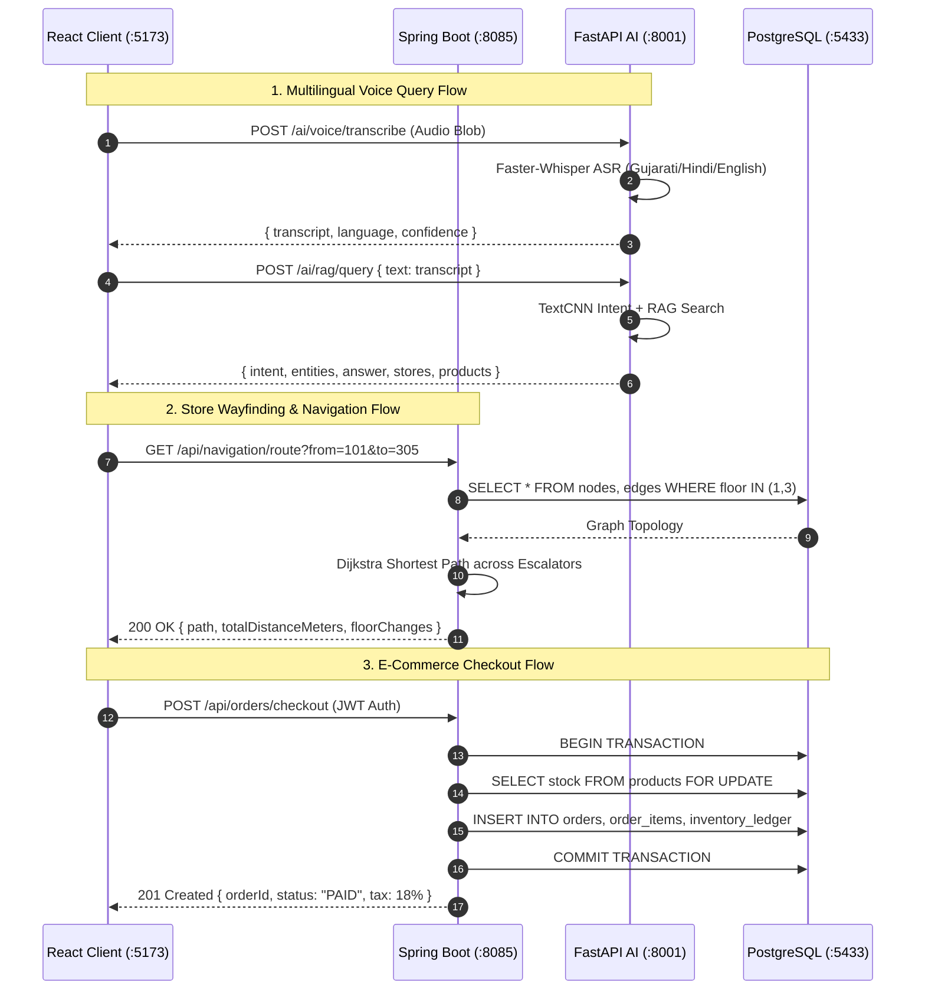

---

## 3. Relational Database Entity-Relationship Diagram (ERD)

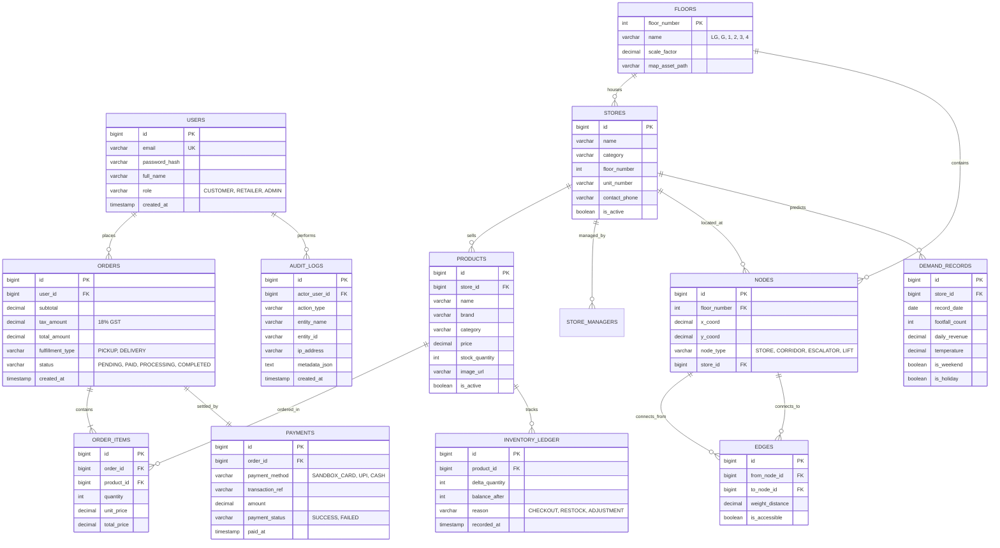

---

## 4. Customer Shopping & Navigation Use Case Diagram

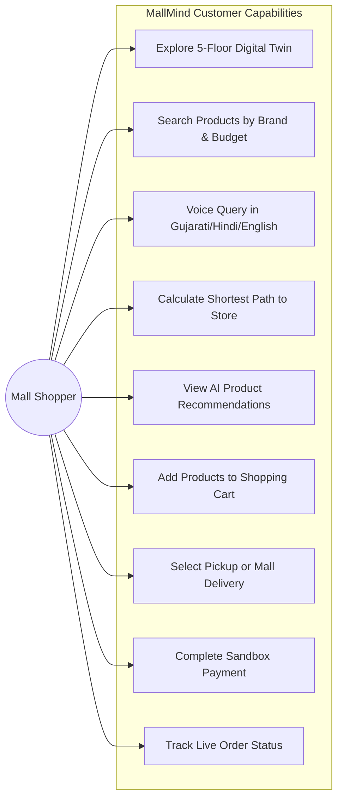

---

## 5. Retailer Store Operations Use Case Diagram

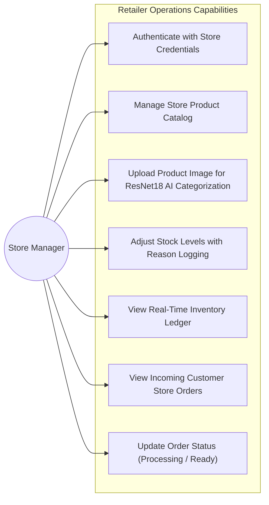

---

## 6. Mall Administrator Operations Use Case Diagram

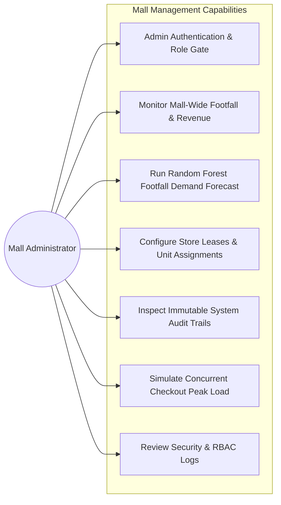

---

## 7. Smart Shopping Cart & E-Commerce Activity Flow

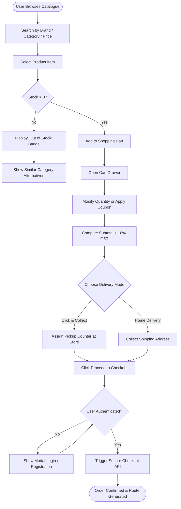

---

## 8. End-to-End Checkout & Transaction Sequence Diagram

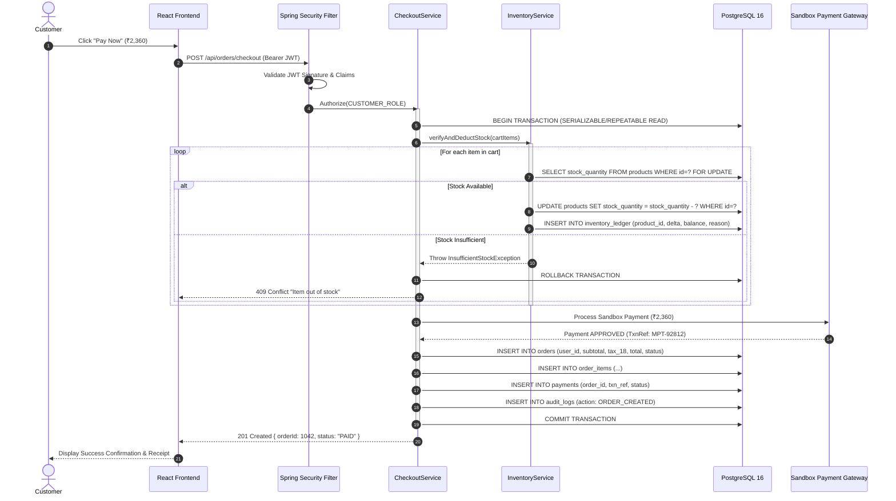

---

## 9. Multilingual Voice Concierge Processing Pipeline

```mermaid
flowchart TD
    UserVoice([User Speaks Query]) --> AudioCapture[MediaRecorder Audio Capture (16kHz WAV)]
    AudioCapture --> Base64[Base64 Encoding / Multipart Upload]
    Base64 --> FastAPIGateway[FastAPI /voice/transcribe Endpoint]

    subgraph ASR_Pipeline["Faster-Whisper Inference Engine"]
        FastAPIGateway --> CTranslate[CTranslate2 Model Loader]
        CTranslate --> AudioPre[Spectrogram & Mel-Filterbank]
        AudioPre --> LangDetect{Detect Language}
        LangDetect -- Gujarati (gu) --> GuModel[Decode Gujarati Syllabary]
        LangDetect -- Hindi (hi) --> HiModel[Decode Devanagari Script]
        LangDetect -- English (en) --> EnModel[Decode English Phonemes]
    end

    GuModel --> Normalizer[Text Normalization & Script Transliteration]
    HiModel --> Normalizer
    EnModel --> Normalizer

    Normalizer --> IntentRouter[Route to Query Understanding Pipeline]
    IntentRouter --> TextCNNClass[TextCNN Deep Learning Classifier]
    IntentRouter --> RuleMatcher[Deterministic Keyword / Brand Filter]

    TextCNNClass --> ConfidenceCheck{Confidence >= 0.70?}
    ConfidenceCheck -- Yes --> FinalIntent[Execute Predicted Intent]
    ConfidenceCheck -- No --> RuleMatcher
    RuleMatcher --> FinalIntent

    FinalIntent --> ResponseGen[Generate Multilingual Response]
    ResponseGen --> TTSOutput[Pyttsx3 / Browser Speech Synthesis Audio]
    TTSOutput --> UserEar([Customer Hears Response & Sees Map Route])
```

---

## 10. RAG Engine & Query Routing Decision Tree

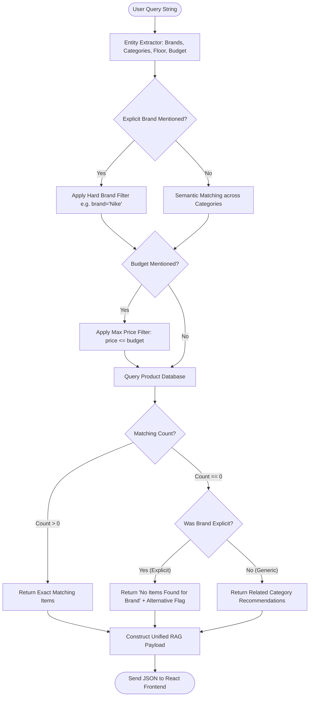

---

## 11. Product Recommendation Engine Pipeline (TF-IDF)

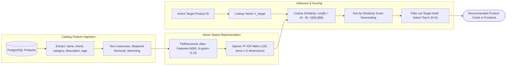

---

## 12. Footfall & Demand Forecasting Pipeline (Random Forest)

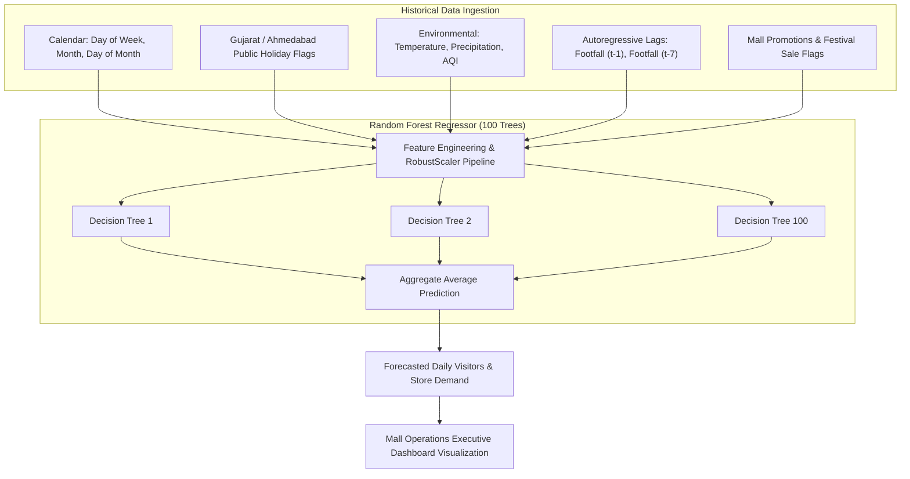

---

## 13. Deep Learning Intent Classification Architecture (TextCNN)

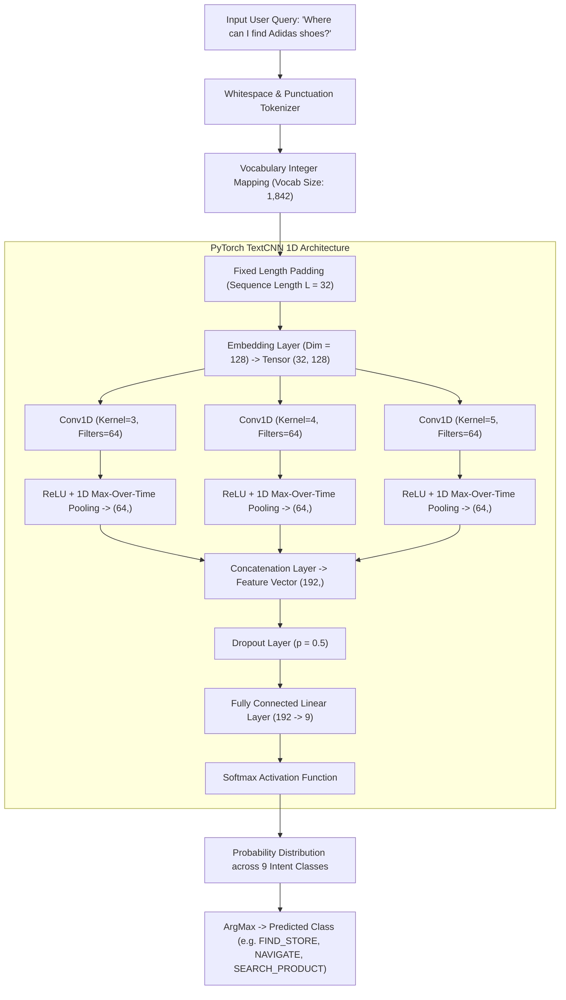

---

## 14. Deep Learning Visual Search Architecture (ResNet18)

```mermaid
flowchart LR
    subgraph Input_Transform["Image Preprocessing Pipeline"]
        Upload[Retailer / Customer Uploaded Image] --> Resize[Resize 256x256]
        Resize --> CenterCrop[Center Crop 224x224]
        CenterCrop --> ToTensor[Convert to Tensor]
        ToTensor --> Normalize["Normalize (Mean=[0.485, 0.456, 0.406], Std=[0.229, 0.224, 0.225])"]
    end

    subgraph ResNet18_Backbone["Pre-trained ResNet18 Feature Extractor"]
        Normalize --> Conv7x7["Conv 7x7, 64, Stride 2"]
        Conv7x7 --> ResBlock1["4x Residual Blocks (Layer 1 - 64-dim)"]
        ResBlock1 --> ResBlock2["4x Residual Blocks (Layer 2 - 128-dim)"]
        ResBlock2 --> ResBlock3["4x Residual Blocks (Layer 3 - 256-dim)"]
        ResBlock3 --> ResBlock4["4x Residual Blocks (Layer 4 - 512-dim)"]
        ResBlock4 --> AvgPool["Adaptive Average Pooling (1x1)"]
        AvgPool --> Flatten["Flatten -> 512-Dimensional Dense Vector"]
    end

    subgraph Category_Classifier["Category Assignment"]
        Flatten --> LinearClass["Linear Projection Head (512 -> 8 Mall Retail Categories)"]
        LinearClass --> CategoryPred["Predicted Category: 'Footwear' (Confidence: 89.4%)"]
    end
```

---

## 15. Multi-Floor Indoor Navigation & Dijkstra Topological Routing

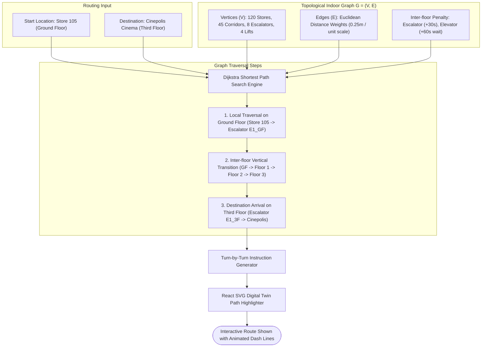

---
*End of Technical Architecture Specification.*
