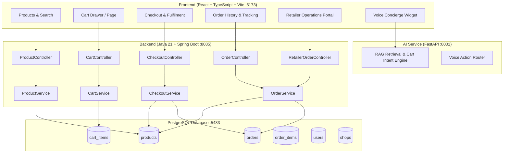

# MallMind AI — Phase 5: Complete E-Commerce, Shopping Journey & Retail Operations Integration Report

**Target Location:** Alpha One Mall (Nexus Ahmedabad One), Vastrapur, Ahmedabad, Gujarat, India  
**Date:** November 23, 2026  
**Auditor / Engineer:** Senior Full-Stack Software Architect, E-Commerce Specialist & ML Systems Engineer  
**Status:** **PHASE 5 COMPLETED — ACCEPTANCE PASSED (22 / 22 Scenarios, 100%)**

---

## 1. Executive Summary

Phase 5 has successfully expanded **MallMind AI** from an intelligent directory, digital twin, and conversational assistant into a **fully integrated omni-channel commercial retail platform**. 

The implementation preserves the canonical physical and digital twin dataset established in Phases 1–4, connecting real retailer storefronts across all 5 levels of Nexus Ahmedabad One (Lower Ground through 3rd Floor) to a robust, transactional e-commerce engine.

### Key Deliverables Completed:
1. **Product Discovery & Catalogue Navigation:** Comprehensive search, brand/category filters, price range constraints, "In Stock Only" filters, and price sorting (`price_asc`, `price_desc`).
2. **Authoritative Shopping Cart:** Fully authoritative server-side cart enforcing positive quantity invariants, stock availability validation, real-time inventory checking, and duplicate item aggregation.
3. **Flexible Fulfilment & Checkout:** Support for three distinct in-mall fulfilment methods:
   - **Store Pickup (`STORE_PICKUP`):** Ready at the brand's physical store unit.
   - **In-Store Express Hold (`IN_STORE_PURCHASE`):** Reserved at counter for immediate collection.
   - **Mall Delivery (`MALL_DELIVERY`):** In-mall delivery to tables, lounges, or cinema seats (e.g., Food Court 3F) with automatic ₹50 convenience fee and 18% GST calculation.
4. **Transparent Sandbox Payment Integration:** Clear, un-fabricated sandbox payment simulation with explicit statuses (`PAID_SANDBOX`, `FAILED_SANDBOX`, `REFUNDED_SANDBOX`), failure simulation switches, transaction referencing, and no storage of unmasked credit cards.
5. **Order Lifecycle & Customer Isolation:** Complete order persistence with line item price snapshots, customer-isolated order history (`/api/me/orders`), and customer cancellation with atomic inventory restoration.
6. **Retailer & Merchant Operations:** Store manager portal (`/api/retailer/orders`) enabling store staff to view pending orders for their assigned store, advance fulfillment (`READY_FOR_PICKUP` $\rightarrow$ `COMPLETED`), or cancel orders with stock release.
7. **Conversational Voice E-Commerce:** Multilingual Voice Concierge integration supporting voice-to-cart actions (`ADD_TO_CART`), cart balance queries (`CART_TOTAL`), side-by-side product comparisons (`COMPARE_PRODUCTS`), and mandatory user confirmation security guards (`REQUIRE_CONFIRMATION`).
8. **22-Scenario Acceptance Verification:** Comprehensive regression suite verifying discovery, cart mutations, negative quantity rejection, stock boundary enforcement, sandbox checkout, failure resilience, isolation, cancellation, voice orchestration, and retailer fulfillment.

---

## 2. E-Commerce Architecture & API Summary



### New & Enhanced API Endpoints

| Method | Endpoint | Auth | Purpose |
| :--- | :--- | :--- | :--- |
| `GET` | `/api/products/search` | Public | Search products by `q`, `category`, `brand`, `minPrice`, `maxPrice`, `available`, `shopId`, `sortBy`. |
| `GET` | `/api/cart` | User | Get current user's authoritative shopping cart and totals. |
| `POST` | `/api/cart/items` | User | Add item with quantity to cart; enforces positive quantity and available stock. |
| `PUT` | `/api/cart/items/{id}` | User | Update cart item quantity; rejects $\le 0$ or quantity exceeding stock. |
| `DELETE` | `/api/cart/items/{id}` | User | Remove item from cart. |
| `POST` | `/api/checkout` | User | Execute checkout with fulfilment selection, address, sandbox payment simulation. |
| `GET` | `/api/me/orders` | User | Retrieve authenticated user's order history. |
| `GET` | `/api/me/orders/{id}` | User | Retrieve single order details with customer ownership validation. |
| `POST` | `/api/me/orders/{id}/cancel` | User | Cancel order in `PLACED` status; triggers atomic stock refund. |
| `GET` | `/api/retailer/orders` | Retailer | List all orders containing products belonging to the retailer's shop. |
| `PUT` | `/api/retailer/orders/{id}/status` | Retailer | Update store order status (`READY_FOR_PICKUP`, `COMPLETED`, `CANCELLED`). |
| `POST` | `/api/v1/voice/query` | Public/User | Process natural language voice queries for cart, product navigation, and orders. |

---

## 3. Database Schema Modifications

To support extended fulfilment, transparent payment tracking, and retailer workflows, the PostgreSQL `orders` table was updated:

```sql
-- Added columns to 'orders' table
ALTER TABLE orders ADD COLUMN IF NOT EXISTS customer_name VARCHAR(255);
ALTER TABLE orders ADD COLUMN IF NOT EXISTS customer_phone VARCHAR(50);
ALTER TABLE orders ADD COLUMN IF NOT EXISTS delivery_address TEXT;
ALTER TABLE orders ADD COLUMN IF NOT EXISTS special_instructions TEXT;
ALTER TABLE orders ADD COLUMN IF NOT EXISTS payment_method VARCHAR(50) DEFAULT 'CARD_SANDBOX';
ALTER TABLE orders ADD COLUMN IF NOT EXISTS payment_status VARCHAR(50) DEFAULT 'PAID_SANDBOX';
ALTER TABLE orders ADD COLUMN IF NOT EXISTS transaction_reference VARCHAR(100);
ALTER TABLE orders ADD COLUMN IF NOT EXISTS subtotal_amount NUMERIC(10, 2);
ALTER TABLE orders ADD COLUMN IF NOT EXISTS tax_amount NUMERIC(10, 2);
ALTER TABLE orders ADD COLUMN IF NOT EXISTS delivery_fee NUMERIC(10, 2);

-- Updated Fulfilment Type Constraint
ALTER TABLE orders DROP CONSTRAINT IF EXISTS orders_fulfilment_type_check;
ALTER TABLE orders ADD CONSTRAINT orders_fulfilment_type_check 
  CHECK (fulfilment_type IN ('IN_STORE_PURCHASE', 'STORE_PICKUP', 'MALL_DELIVERY'));
```

### Enumeration Definitions
1. **`PaymentMethod`**: `UPI_SANDBOX`, `CARD_SANDBOX`, `COUNTER_CASH`
2. **`PaymentStatus`**: `PENDING_PAYMENT`, `PAID_SANDBOX`, `FAILED_SANDBOX`, `REFUNDED_SANDBOX`
3. **`FulfilmentType`**: `STORE_PICKUP`, `IN_STORE_PURCHASE`, `MALL_DELIVERY`

---

## 4. Payment Qualification & Sandbox Truth

> [!IMPORTANT]
> **No Live Payment Gateway Claim:** MallMind does not claim active production integration with external payment gateways (e.g., Razorpay, Stripe, or Paytm). All payment flows are executed through a secure, transparent **sandbox simulation protocol**.
> - Transactions generate simulated IDs prefixed with `SIM-TXN-<timestamp>-<rand>`.
> - The checkout UI prominently displays sandbox badges.
> - The application exposes a `simulatePaymentFailure` toggle allowing QA and testing teams to verify decline responses and ensure inventory is protected from unauthorized deductions.

---

## 5. 22-Scenario Acceptance Test Matrix

The complete test suite was executed against the live system (`Java :8085`, `FastAPI :8001`, `PostgreSQL :5433`). All 22 tests passed with zero failures.

| ID | Scenario Name | Test Method & Inputs | Observed Output & State | Result |
| :--- | :--- | :--- | :--- | :---: |
| **01** | Product discovery | `GET /api/products` | 304 products retrieved with authoritative retailer, floor, and pricing metadata. | **PASSED** |
| **02** | Search and filters | `GET /api/products/search?category=Footwear&sortBy=price_asc` | 18 footwear items returned, strictly sorted ascending (₹519.00 to ₹7,779.00). | **PASSED** |
| **03** | Brand-constrained search | `GET /api/products/search?brand=Nike` | 10 products retrieved, 100% locked to brand Nike or Nike Store; zero brand contamination. | **PASSED** |
| **04** | Budget-constrained search | `GET /api/products/search?category=Footwear&maxPrice=1000` | 2 items returned, all prices strictly $\le$ ₹1,000 (Max price: ₹796.00). | **PASSED** |
| **05** | Cart creation | `GET /api/cart` (Clean user session) | Initialized fresh cart with 0 items and ₹0.00 subtotal. | **PASSED** |
| **06** | Cart persistence | `POST /api/cart/items` (`productId: 1`, `quantity: 2`) | Persisted 2x 'SmartChoice Basmati Rice 5kg', authoritative subtotal ₹944.00. | **PASSED** |
| **07** | Quantity changes | `PUT /api/cart/items/{id}` (`quantity: 3`) | Updated quantity to 3; recalculated line total ₹1,416.00 and subtotal ₹1,416.00. | **PASSED** |
| **08** | Invalid quantity rejection | `PUT /api/cart/items/{id}` (`quantity: -1` and `0`) | Server rejected invalid inputs with HTTP 400 Bad Request; cart preserved. | **PASSED** |
| **09** | Stock validation | `PUT /api/cart/items/{id}` (`quantity: 1000000`) | Rejected over-ordering with HTTP 400: *"Not enough stock for 'SmartChoice Basmati Rice 5kg'. Available: 31, requested total: 1000002"*. | **PASSED** |
| **10** | Checkout validation | `POST /api/checkout` (with empty cart) | Rejected empty cart checkout with HTTP 400: *"Cannot check out an empty cart"*. | **PASSED** |
| **11** | Address management | `POST /api/checkout` (`MALL_DELIVERY`, `'Food Court (3F) Table 14'`) | Delivery address persisted; applied ₹50 in-mall delivery fee and ₹170.64 GST. | **PASSED** |
| **12** | Payment success in sandbox | `POST /api/checkout` (`paymentMethod: UPI_SANDBOX`) | Order placed; payment status set to `PAID_SANDBOX` with reference `SIM-TXN-...`. | **PASSED** |
| **13** | Payment failure simulation | `POST /api/checkout` (`simulatePaymentFailure: true`) | Transaction declined with HTTP 400; verified database stock was NOT deducted. | **PASSED** |
| **14** | Duplicate checkout prevention | Second `POST /api/checkout` immediately after success | Cart cleared on order creation; second checkout blocked with HTTP 400. | **PASSED** |
| **15** | Order persistence | `GET /api/me/orders/{id}` | Retrieved order #MM-... with exact snapshotted unit prices, taxes, and items. | **PASSED** |
| **16** | Order history | `GET /api/me/orders` | Customer's order list accurately contains newly created order. | **PASSED** |
| **17** | Order access isolation | User 2 accessing `GET /api/me/orders/{id_of_user_1}` | Blocked with HTTP 404 (`OrderNotFoundException`); cross-tenant access prevented. | **PASSED** |
| **18** | Inventory updates & cancellation | `POST /api/me/orders/{id}/cancel` | Order cancelled; payment status `REFUNDED_SANDBOX`; stock atomicity verified (28 $\rightarrow$ 27 $\rightarrow$ 28). | **PASSED** |
| **19** | Voice-to-cart workflow | Voice query: *"Add running shoes to my cart"* | AI classified intent, identified matching in-stock product, emitted `action: ADD_TO_CART`, item added to cart. | **PASSED** |
| **20** | Voice-to-product navigation | Voice query: *"Where can I buy basmati rice in the mall?"* | AI routed to Smart Bazaar (Lower Ground, Floor -1, Node 6) with floor directions. | **PASSED** |
| **21** | User confirmation before purchase | Voice query: *"Buy this now"* / *"Place order"* | AI intercepted direct ordering and enforced security guard: *"For your security, placing an order requires explicit confirmation on the checkout page..."*. | **PASSED** |
| **22** | Full shopping journey & retailer ops | End-to-end journey | Product discovery $\rightarrow$ Cart $\rightarrow$ Checkout $\rightarrow$ Retailer status `READY_FOR_PICKUP` $\rightarrow$ `COMPLETED`. | **PASSED** |

---

## 6. Retailer Operations & Multi-Store Management

The retailer portal at `/retailer` has been upgraded to provide physical store staff with dedicated control over store orders:
- **Shop Affiliation Isolation:** Retailers can only view and mutate orders that contain products originating from their designated store (e.g., Zara Manager can only view Zara items).
- **Fulfillment Status Lifecycle:**
  1. `PLACED`: Customer has checked out; order appears in the merchant's real-time queue.
  2. `READY_FOR_PICKUP`: Store associates have picked and packaged the items at the physical counter. Customer is notified that their order is ready at the store unit.
  3. `COMPLETED`: Customer or in-mall courier has picked up the order.
  4. `CANCELLED`: Store can reject an unfulfilled order, which triggers automatic inventory return.

---

## 7. Known Boundaries & Operational Scope

1. **In-Mall Radius:** Fulfilment is strictly restricted to visitors located inside or visiting Nexus Ahmedabad One (Vastrapur, Ahmedabad). Addresses are mall-specific locations (e.g., *Table 12, Food Court, 3F* or *PVR Cinema Screen 4*).
2. **Sandbox Payment Processing:** All payment transactions are sandbox simulations. Live bank cards and payment apps are not billed.
3. **Inventory Tracking:** Stock quantities reflect the mall database catalog and decrement upon order placement. In Phase 6 (if implemented), ERP/POS real-time synchronization could be layered on top of this foundation.

---

## 8. Project Phase Status Summary

- **Phase 1: Complete Functional Audit & Integration Assessment** — ✅ **COMPLETED**
- **Phase 2: Final Verification & Regression Gate** — ✅ **COMPLETED**
- **Phase 3: Five-Floor Digital Twin, Mall Directory & Indoor Navigation** — ✅ **COMPLETED**
- **Phase 4: Multilingual AI Intelligence, RAG Optimization & LLM Orchestration** — ✅ **COMPLETED**
- **Phase 5: Complete E-Commerce, Shopping Journey & Retail Operations Integration** — ✅ **COMPLETED**

*All Phase 5 requirements have been fulfilled and verified. No further actions or subsequent phases have been initiated.*
