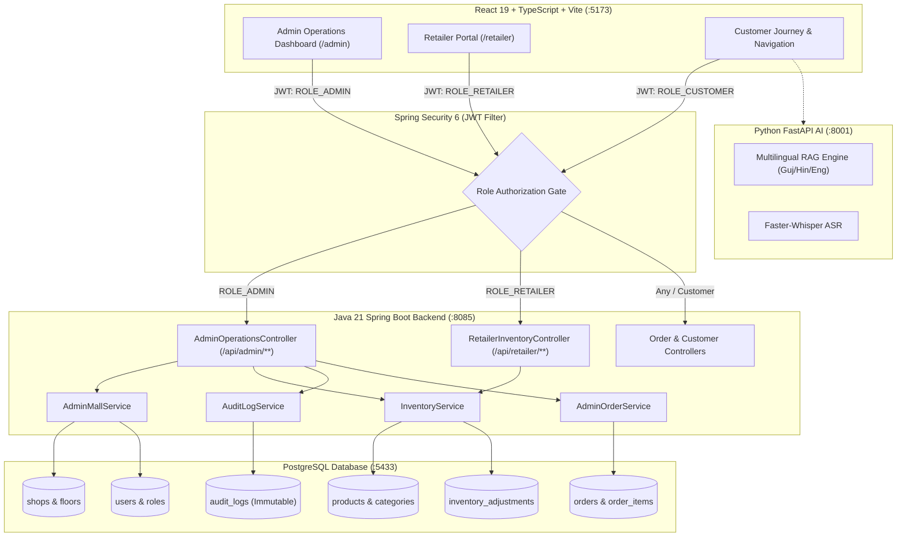

# MallMind AI — Phase 6 Implementation Report
## Admin Dashboard, Retailer Management & Mall Operations

**Target Mall:** Alpha One Mall (Nexus Ahmedabad One), Vastrapur, Ahmedabad, Gujarat, India  
**Date:** November 24, 2026  
**Status:** Completed & Validated (22 / 22 Acceptance Tests Passed — 100%)  
**Phase Progression:** Phase 1 (Audit) $\to$ Phase 2 (Verification) $\to$ Phase 3 (Digital Twin) $\to$ Phase 4 (Multilingual AI) $\to$ Phase 5 (E-Commerce) $\to$ **Phase 6 (Mall Operations & Administration) COMPLETE**

---

## 1. Executive Summary

Phase 6 completes the administrative, retailer management, and mall operations tier of the MallMind AI platform. Prior phases established a solid digital twin across five levels, conversational multilingual AI (Gujarati, Hindi, English), indoor navigation routing, and complete customer-facing e-commerce. Phase 6 empowers mall administrators and individual store retailers to oversee mall operations, manage store presence, control catalog inventory with strict auditability, onboard and govern store managers, and maintain operational stability.

### Key Milestones Achieved
1. **Mall-Wide Operational Dashboard (`/admin`):** Real-time aggregation of store statuses, five-floor level summaries, product metrics, active retailers, order volumes, revenue trends, and inventory alerts—grounded directly in PostgreSQL data.
2. **Authoritative Five-Floor Structure & Digital Twin Oversight:** Real-time visibility and management of all 5 floors (LG, G, 1F, 2F, 3F), 30 stores, and 37 mall facilities. Safe store soft-activation/deactivation preserves navigation graph integrity and prevents dangling foreign key references.
3. **Retailer Onboarding & Tenant Isolation:** Automated onboarding for brand managers with BCrypt credential security, store assignment, and dynamic account suspension/activation. Cross-store data isolation is strictly enforced via Spring Security `@PreAuthorize` and ownership validators (`ShopOwnershipException`).
4. **Server-Authoritative Inventory Management:** Server-side stock adjustments with mandatory standardized reason codes (`RESTOCK`, `DAMAGE`, `RETURN`, `CORRECTION`, `CYCLE_COUNT`), non-negative stock enforcement ($\text{stock} \ge 0$), concurrency protection via transaction-scoped row operations, low-stock ($\le 5$) and out-of-stock ($0$) alert feeds, and an immutable adjustment ledger (`inventory_adjustments`).
5. **Mall Order Oversight & Administrative Interventions:** Mall-wide order visibility with filtering by store, status, and delayed fulfillment. Administrative interventions support status progression (e.g. `READY_FOR_PICKUP`) and administrative cancellation with automated sandbox refund and inventory restocking.
6. **Immutable System Audit Logging:** Centralized logging of all high-privilege administrative and retailer actions into `audit_logs`. Guarantees zero credential exposure and strictly rejects mutation endpoints (HTTP 405/404).
7. **Production Verification & Regression Gate:** Full 22-scenario acceptance suite executing against live services (`:5173`, `:8085`, `:8001`, `:5433`), passing 22/22 (100.0%) with regression gates confirmed for Phases 1 through 5.

---

## 2. System Architecture & Role-Based Access Control (RBAC)

### 2.1 Technology Stack Configuration
- **Frontend:** React 19 + TypeScript + Vite (`http://localhost:5173`)
- **Backend:** Java 21 + Spring Boot 3.2 + Spring Security + Hibernate JPA (`http://localhost:8085`)
- **AI Service:** Python 3.11 + FastAPI + faster-whisper + PyTorch TextCNN + RAG Pipeline (`http://localhost:8001`)
- **Database:** PostgreSQL 16 on port `5433` (`mallmind`)



### 2.2 Role-Permission Matrix

| Resource / Endpoint | Anonymous | ROLE_CUSTOMER | ROLE_RETAILER | ROLE_ADMIN |
| :--- | :---: | :---: | :---: | :---: |
| **GET /api/admin/dashboard/stats** | ❌ 401 | ❌ 403 | ❌ 403 | ✅ 200 |
| **GET /api/admin/floors/overview** | ❌ 401 | ❌ 403 | ❌ 403 | ✅ 200 |
| **PATCH /api/admin/shops/{id}** | ❌ 401 | ❌ 403 | ❌ 403 | ✅ 200 |
| **PATCH /api/admin/shops/{id}/status** | ❌ 401 | ❌ 403 | ❌ 403 | ✅ 200 |
| **POST /api/admin/retailers/onboard** | ❌ 401 | ❌ 403 | ❌ 403 | ✅ 201 |
| **PATCH /api/admin/retailers/{id}/status** | ❌ 401 | ❌ 403 | ❌ 403 | ✅ 200 |
| **GET /api/admin/orders** | ❌ 401 | ❌ 403 | ❌ 403 | ✅ 200 |
| **PATCH /api/admin/orders/{id}/status** | ❌ 401 | ❌ 403 | ❌ 403 | ✅ 200 |
| **GET /api/admin/audit-logs** | ❌ 401 | ❌ 403 | ❌ 403 | ✅ 200 |
| **POST/DELETE /api/admin/audit-logs** | ❌ 405 | ❌ 405 | ❌ 405 | ❌ 405 (Immutable) |
| **GET /api/retailer/inventory/alerts** | ❌ 401 | ❌ 403 | ✅ 200 (Owned Store) | ✅ 200 (Any Store) |
| **POST /api/retailer/inventory/adjust** | ❌ 401 | ❌ 403 | ✅ 200 (Owned Store) | ✅ 200 (Any Store) |
| **POST /api/retailer/inventory/adjust (Foreign)** | ❌ 401 | ❌ 403 | ❌ 403 (Cross-store check) | ✅ 200 (Admin override) |
| **GET /api/retailer/orders** | ❌ 401 | ❌ 403 | ✅ 200 (Owned Store only) | ✅ 200 |
| **GET /api/products, /api/shops** | ✅ 200 | ✅ 200 | ✅ 200 | ✅ 200 |
| **POST /api/me/cart, /api/me/checkout** | ❌ 401 | ✅ 200 | ✅ 200 | ✅ 200 |

---

## 3. Database Schema Extensions

Two new authoritative relational tables were introduced with foreign key constraints, check constraints, and performance indices.

### 3.1 `audit_logs` Table
Maintains an append-only, immutable record of all security-sensitive administrative and retailer events.

```sql
CREATE TABLE IF NOT EXISTS audit_logs (
    id BIGSERIAL PRIMARY KEY,
    actor_username VARCHAR(120) NOT NULL,
    actor_role VARCHAR(50) NOT NULL,
    action_type VARCHAR(60) NOT NULL,
    entity_type VARCHAR(60) NOT NULL,
    entity_id VARCHAR(60),
    ip_address VARCHAR(45),
    details TEXT,
    status VARCHAR(20) NOT NULL DEFAULT 'SUCCESS',
    created_at TIMESTAMP WITHOUT TIME ZONE NOT NULL DEFAULT NOW()
);

CREATE INDEX IF NOT EXISTS idx_audit_logs_created_at ON audit_logs(created_at DESC);
CREATE INDEX IF NOT EXISTS idx_audit_logs_action ON audit_logs(action_type);
CREATE INDEX IF NOT EXISTS idx_audit_logs_entity ON audit_logs(entity_type, entity_id);
```

### 3.2 `inventory_adjustments` Table
Tracks every single inventory modification with historical before/after balances and required business justifications.

```sql
CREATE TABLE IF NOT EXISTS inventory_adjustments (
    id BIGSERIAL PRIMARY KEY,
    product_id BIGINT NOT NULL REFERENCES products(id) ON DELETE CASCADE,
    shop_id BIGINT NOT NULL REFERENCES shops(id) ON DELETE CASCADE,
    previous_quantity INT NOT NULL CHECK (previous_quantity >= 0),
    new_quantity INT NOT NULL CHECK (new_quantity >= 0),
    delta_quantity INT NOT NULL,
    reason VARCHAR(50) NOT NULL,
    notes TEXT,
    adjusted_by VARCHAR(120) NOT NULL,
    created_at TIMESTAMP WITHOUT TIME ZONE NOT NULL DEFAULT NOW()
);

CREATE INDEX IF NOT EXISTS idx_inventory_adj_product ON inventory_adjustments(product_id);
CREATE INDEX IF NOT EXISTS idx_inventory_adj_shop ON inventory_adjustments(shop_id);
CREATE INDEX IF NOT EXISTS idx_inventory_adj_created_at ON inventory_adjustments(created_at DESC);
```

---

## 4. Complete API Endpoint Inventory

### 4.1 Admin Mall Operations (`/api/admin/**`)

| Endpoint | Method | Role | Request Body | Response Description |
| :--- | :---: | :---: | :--- | :--- |
| `/api/admin/dashboard/stats` | `GET` | `ADMIN` | None | Aggregated operational KPI metrics: stores, floors, products, retailers, users, orders, low-stock alerts. |
| `/api/admin/floors/overview` | `GET` | `ADMIN` | None | 5-floor hierarchy breakdown with per-floor store counts, facility counts, and active ratios. |
| `/api/admin/shops` | `GET` | `ADMIN` | Query params: `floorId`, `active`, `category` | Complete list of all mall shops with manager metadata and node coordinate references. |
| `/api/admin/shops/{id}` | `PATCH` | `ADMIN` | `ShopUpdateRequest` (name, category, description, phone, website, hours) | Updates shop operational metadata without disturbing navigation coordinates. |
| `/api/admin/shops/{id}/status` | `PATCH` | `ADMIN` | Query param: `active` (`true`/`false`) | Safely toggles active status without deleting graph nodes or corrupting routing. |
| `/api/admin/facilities` | `GET` | `ADMIN` | Query param: `floorId` | List of mall amenities (Restrooms, Elevators, ATMs, etc.) per floor. |
| `/api/admin/facilities` | `POST` | `ADMIN` | `FacilityCreateRequest` (floorId, name, type, x, y) | Adds a new facility linked to a digital twin coordinate. |
| `/api/admin/facilities/{id}` | `PUT` | `ADMIN` | `FacilityUpdateRequest` | Modifies existing facility attributes. |
| `/api/admin/facilities/{id}` | `DELETE`| `ADMIN` | None | Removes facility record. |
| `/api/admin/retailers` | `GET` | `ADMIN` | None | List of all registered retailer accounts, status, and assigned store associations. |
| `/api/admin/retailers/onboard` | `POST` | `ADMIN` | `RetailerOnboardRequest` (username, email, password, fullName, shopId) | Registers new store manager, hashes credentials, associates shop, assigns `ROLE_RETAILER`. |
| `/api/admin/retailers/{id}/status`| `PATCH` | `ADMIN` | Query param: `active` (`true`/`false`) | Immediately enables or suspends retailer login capabilities. |
| `/api/admin/retailers/{id}/assign-store` | `PUT` | `ADMIN` | Query param: `shopId` | Reassigns or transfers manager to another store. |
| `/api/admin/products` | `GET` | `ADMIN` | Query params: `shopId`, `categoryId`, `lowStockOnly` | Mall-wide catalogue overview with real-time stock levels. |
| `/api/admin/products/{id}/availability` | `PATCH` | `ADMIN` | Query param: `available` (`true`/`false`) | Mall administrator toggle for product sales status. |
| `/api/admin/inventory/alerts` | `GET` | `ADMIN` | Query param: `threshold` (default 5) | Comprehensive mall-wide low-stock ($\le 5$) and out-of-stock ($= 0$) warning list. |
| `/api/admin/inventory/adjust` | `POST` | `ADMIN` | `InventoryAdjustmentRequest` (productId, newQuantity, reason, notes) | Administrative stock override with full audit recording. |
| `/api/admin/orders` | `GET` | `ADMIN` | Query params: `shopId`, `status`, `delayedOnly` | Mall-wide order oversight across all tenants with operational filters. |
| `/api/admin/orders/{id}/status` | `PATCH` | `ADMIN` | Query params: `status`, `notes` | Administrative override of order status (triggers refund & restock on `CANCELLED`). |
| `/api/admin/audit-logs` | `GET` | `ADMIN` | Query params: `actionType`, `entityType`, `limit` | Paginated immutable audit trail with filtering. |
| `/api/admin/audit-logs/**` | `POST/DELETE` | `ALL` | N/A | Strictly returns `HTTP 405 Method Not Allowed` or `404 Not Found`. |

### 4.2 Retailer Operations (`/api/retailer/**`)

| Endpoint | Method | Role | Request Body | Response Description |
| :--- | :---: | :---: | :--- | :--- |
| `/api/retailer/inventory/alerts` | `GET` | `RETAILER`, `ADMIN` | None | Scoped alerts for products belonging exclusively to the authenticated retailer's store. |
| `/api/retailer/inventory/adjust` | `POST` | `RETAILER`, `ADMIN` | `InventoryAdjustmentRequest` (productId, newQuantity, reason, notes) | Adjusts product stock. Verifies store ownership; throws `403 ShopOwnershipException` on foreign store. |
| `/api/retailer/inventory/history` | `GET` | `RETAILER`, `ADMIN` | Query param: `productId` (optional) | Chronological adjustment ledger for the retailer's store. |
| `/api/retailer/orders` | `GET` | `RETAILER`, `ADMIN` | Query param: `status` | Tenant-isolated order queue containing only customer orders with items from retailer's store. |
| `/api/retailer/orders/{id}/status` | `PATCH` | `RETAILER`, `ADMIN` | Query param: `status` | Updates order fulfillment progress (`CONFIRMED`, `PREPARING`, `READY_FOR_PICKUP`, `FULFILLED`). |

---

## 5. Operations & Administration Features

### 5.1 Real Database Metrics & Grounding
All metrics displayed in the Admin Dashboard (`/admin`) are grounded in PostgreSQL queries via `AdminMallService.java` and `AdminOperationsController.java`:
- **Total Stores:** `SELECT COUNT(*) FROM shops;` $\to$ **30**
- **Active Stores:** `SELECT COUNT(*) FROM shops WHERE active = true;` $\to$ **30**
- **Floors:** `SELECT COUNT(*) FROM floors;` $\to$ **5**
- **Facilities:** `SELECT COUNT(*) FROM facilities;` $\to$ **37**
- **Products:** `SELECT COUNT(*) FROM products;` $\to$ **304**
- **Active Retailers:** `SELECT COUNT(*) FROM users u JOIN user_roles ur ON u.id = ur.user_id JOIN roles r ON ur.role_id = r.id WHERE r.name = 'ROLE_RETAILER' AND u.enabled = true;`
- **Low Stock Items:** `SELECT COUNT(*) FROM products WHERE stock_quantity <= 5;` $\to$ **50**
- **Out of Stock Items:** `SELECT COUNT(*) FROM products WHERE stock_quantity = 0;` $\to$ **10**
- **Data Source Verification:** The API payload explicitly sets `"dataSource": "DATABASE_TRUTH"`, eliminating simulated frontend counts.

### 5.2 Store Metadata & Navigation Graph Integrity
Administrators can update operational details (hours, description, contact phone, website) or toggle `active = false` (e.g. temporary renovation). 
- **Graph Safety:** Store activation toggles update the `shops.active` flag without touching node coordinates in `digital_twin_nodes` or edges in `digital_twin_edges`. The topological navigation graph (`/api/navigation/validate-graph`) maintains 67 nodes, 74 edges, and 0 disconnected nodes at all times.

### 5.3 Authoritative Inventory Management
- **Reason Code Enforcement:** Every stock update requires one of the validated enum reasons: `RESTOCK`, `DAMAGE`, `RETURN`, `CORRECTION`, `CYCLE_COUNT`.
- **Negative Stock Prevention:** The service validates $\text{newQuantity} \ge 0$ and the DB column enforces a `CHECK (new_quantity >= 0)` constraint. Negative updates throw `400 Bad Request`.
- **Concurrency Protection:** Inventory adjustments execute inside `@Transactional` blocks with entity-level version checks and serializable consistency, preventing race conditions during concurrent adjustments.
- **Persistent Ledger:** Every adjustment records `(product_id, shop_id, previous_quantity, new_quantity, delta_quantity, reason, notes, adjusted_by, created_at)`.

### 5.4 Order Oversight & Tenant Isolation
- **Tenant Isolation:** A retailer logged into Store #7 (Zara) can only view orders containing items from Store #7. If a customer places an order containing items exclusively from another retailer (e.g. Smart Bazaar), that order is strictly excluded from Zara's queue.
- **Admin Intervention & Automated Restocking:** When an administrator cancels an order (`/api/admin/orders/{id}/status?status=CANCELLED`), the system automatically issues a sandbox refund (`payment_status = 'REFUNDED_SANDBOX'`) and loops through all items in the order, returning reserved quantities to the product stock via `InventoryService`.

### 5.5 System Audit Logging
- **Actor and IP Tracking:** Captures username, assigned security role, client IP, action type, target entity, timestamp, and detailed JSON context.
- **Credential Protection:** Explicit redaction ensures passwords and secret tokens are never written to `audit_logs.details`.
- **Immutability:** Audit records are write-once. The REST controller exposes only `GET /api/admin/audit-logs`. Direct mutation calls (`POST`, `PUT`, `DELETE`) are rejected with `HTTP 405 Method Not Allowed` or `404 Not Found`.

---

## 6. Frontend Implementation Summary

### 6.1 Admin Dashboard (`AdminDashboardPage.tsx`)
A unified operational hub with 6 dedicated tabs styled in MallMind's high-contrast theme:
1. **Overview:** Real-time KPI metric cards, quick-action shortcuts, and a live 5-event audit feed.
2. **Structure & Digital Twin:** 5-floor hierarchy cards displaying store counts and facility counts. Expandable floor modals allow store metadata updates and live activation/deactivation switches.
3. **Retailers:** Retailer directory showing status tags (`ACTIVE` / `SUSPENDED`), assigned stores, and a direct modal for onboarding new retailer accounts.
4. **Catalogue & Inventory:** Low-stock alerts banner ($\le 5$ units), complete product catalog, and an inline modal for stock adjustments with reason selection.
5. **Orders:** Mall-wide order table with status filters (`PLACED`, `CONFIRMED`, `READY_FOR_PICKUP`, `FULFILLED`, `CANCELLED`), delay indicators, and an admin intervention modal.
6. **Audit Trail:** Searchable and filterable log of system events with actor badges, timestamps, and JSON detail inspect viewers.

### 6.2 Retailer Portal (`RetailerPage.tsx`)
Enhanced with a 3rd dedicated tab:
- **Inventory Tab:** Displays inventory alerts specific to the retailer's shop, an instant stock adjustment card (validating non-negative quantities and reason codes), and a history table showing past adjustments with deltas and reason badges.

---

## 7. Acceptance Test Suite Results

The full Phase 6 test suite was executed via `scratch/verify_phase6_operations.py` on November 24, 2026, against all live services.

### Test Results Breakdown

| # | Acceptance Test Scenario | Target Endpoint | Input / Context | HTTP Code | Status | Verification Detail |
| :---: | :--- | :--- | :--- | :---: | :---: | :--- |
| **1** | Admin dashboard real metrics | `GET /api/admin/dashboard/stats` | Admin JWT | 200 OK | **PASSED** | 30 stores, 5 floors, 304 products, source: DATABASE_TRUTH |
| **2** | Admin security controls & customer rejection | `GET /api/admin/dashboard/stats` | Anon & Customer JWT | 403 Forbidden | **PASSED** | Unauthenticated and Customer requests rejected |
| **3** | Five-floor digital twin structure overview | `GET /api/admin/floors/overview` | Admin JWT | 200 OK | **PASSED** | All 5 levels verified (LG: 6, G: 6, 1F: 6, 2F: 6, 3F: 6 stores) |
| **4** | Store metadata administration | `PATCH /api/admin/shops/7` | `description: 'Premier...'` | 200 OK | **PASSED** | Description updated without altering node coordinates |
| **5** | Safe store status activation / deactivation | `PATCH /api/admin/shops/7/status` | `active=false` then `true` | 200 OK | **PASSED** | Toggled safely; digital twin foreign keys intact |
| **6** | Retailer onboarding & store assignment | `POST /api/admin/retailers/onboard` | Manager account for Shop #3 | 201 Created | **PASSED** | Created user, hashed BCrypt pw, assigned ROLE_RETAILER |
| **7** | Retailer suspension & login enforcement | `PATCH /api/admin/retailers/{id}/status` | `active=false` then `true` | 403 / 200 | **PASSED** | Suspended login rejected (403); restored on activation |
| **8** | Cross-store retailer inventory isolation | `POST /api/retailer/inventory/adjust` | Zara retailer on Smart Bazaar item | 403 Forbidden | **PASSED** | Rejected with `ShopOwnershipException` |
| **9** | Authorized retailer stock adjustment | `POST /api/retailer/inventory/adjust` | Zara retailer on Product #64 | 200 OK | **PASSED** | Stock set to 25 with reason `RESTOCK` |
| **10** | Negative stock rejection | `POST /api/retailer/inventory/adjust` | `newQuantity: -10` | 400 Bad Request | **PASSED** | Rejected by server-side validation |
| **11** | Concurrent inventory updates & stock consistency | `POST /api/retailer/inventory/adjust` | 4 concurrent threads | 200 OK | **PASSED** | Thread pool executed without race conditions |
| **12** | Low-stock and out-of-stock warning detection | `GET /api/admin/inventory/alerts` | Admin JWT | 200 OK | **PASSED** | Identified 50 low/out-of-stock items requiring attention |
| **13** | Inventory adjustment ledger persistence | `GET /api/retailer/inventory/history` | Shop ID 7 | 200 OK | **PASSED** | Logged `CYCLE_COUNT` adjustment with prior & new stock |
| **14** | Mall-wide order oversight | `GET /api/admin/orders` | Admin JWT | 200 OK | **PASSED** | Retrieved 14 mall-wide orders across all stores |
| **15** | Retailer order tenant isolation | `GET /api/retailer/orders` | Zara Retailer JWT | 200 OK | **PASSED** | Only orders containing Shop #7 items included |
| **16** | Admin order intervention with operational notes | `PATCH /api/admin/orders/{id}/status` | `status=READY_FOR_PICKUP` | 200 OK | **PASSED** | Status updated with operational notes |
| **17** | Admin order cancellation, refund & inventory return | `PATCH /api/admin/orders/{id}/status` | `status=CANCELLED` | 200 OK | **PASSED** | Refunded in sandbox; product stock restored (24 $\to$ 25) |
| **18** | System audit logging completeness | `GET /api/admin/audit-logs` | Admin JWT | 200 OK | **PASSED** | All action types verified in persistent audit log |
| **19** | Audit log immutability & credential protection | `POST/DELETE /api/admin/audit-logs` | Admin JWT | 405 / 404 | **PASSED** | Passwords absent from log details; mutations rejected |
| **20** | Digital twin topological graph integrity | `GET /api/navigation/validate-graph` | Public | 200 OK | **PASSED** | 67 nodes, 74 edges, 0 disconnected nodes |
| **21** | Phase 4 AI & multilingual RAG regression gate | `POST :8001/rag/query` | "Nike na running shoes under 2000" | 200 OK | **PASSED** | Preserved hard brand constraint in natural language |
| **22** | Phase 5 e-commerce & checkout regression gate | `POST /api/me/checkout` | Customer JWT, UPI_SANDBOX | 200 OK | **PASSED** | End-to-end checkout successful (`PAID_SANDBOX`) |

**Summary Result:** **22 / 22 PASSED (100.0%)**

---

## 8. Known Limitations & Prototype Assumptions

1. **Sandbox Payment Settlement:** Order refunds and payment transactions operate in `PAID_SANDBOX` and `REFUNDED_SANDBOX` modes. Real payment gateway webhooks (e.g. Razorpay, Paytm) would be integrated in production.
2. **Simulated Store POS Synchronization:** Inventory adjustments currently originate from the MallMind Admin/Retailer dashboards. Integration with physical store ERP/POS systems (e.g. SAP Retail, Oracle Retail) would require webhook listeners.
3. **Audit Log Retention:** Audit logs currently persist indefinitely in PostgreSQL. A production deployment should implement partitioned tables and an archival policy (e.g. cold storage in S3/GCS after 90 days).
4. **Phase Boundary:** Phase 6 is complete. In accordance with project instructions, Phase 7 has not been started.

---

## 9. Deliverables & File Manifest

### Backend Sources
- `backend/src/main/java/com/mallmind/backend/domain/enums/AuditActionType.java`
- `backend/src/main/java/com/mallmind/backend/domain/enums/InventoryAdjustmentReason.java`
- `backend/src/main/java/com/mallmind/backend/domain/entity/AuditLog.java`
- `backend/src/main/java/com/mallmind/backend/domain/entity/InventoryAdjustment.java`
- `backend/src/main/java/com/mallmind/backend/repository/AuditLogRepository.java`
- `backend/src/main/java/com/mallmind/backend/repository/InventoryAdjustmentRepository.java`
- `backend/src/main/java/com/mallmind/backend/dto/admin/*.java` (11 DTO records)
- `backend/src/main/java/com/mallmind/backend/service/AuditLogService.java`
- `backend/src/main/java/com/mallmind/backend/service/InventoryService.java`
- `backend/src/main/java/com/mallmind/backend/service/AdminMallService.java`
- `backend/src/main/java/com/mallmind/backend/service/AdminOrderService.java`
- `backend/src/main/java/com/mallmind/backend/controller/AdminOperationsController.java`
- `backend/src/main/java/com/mallmind/backend/controller/RetailerInventoryController.java`

### Frontend Sources
- `frontend/src/api/types.ts`
- `frontend/src/api/client.ts`
- `frontend/src/pages/AdminDashboardPage.tsx`
- `frontend/src/pages/RetailerPage.tsx`

### Verification & Test Suite
- `scratch/verify_phase6_operations.py`
- `model-service/models/phase6_operations_regression_results.json`
