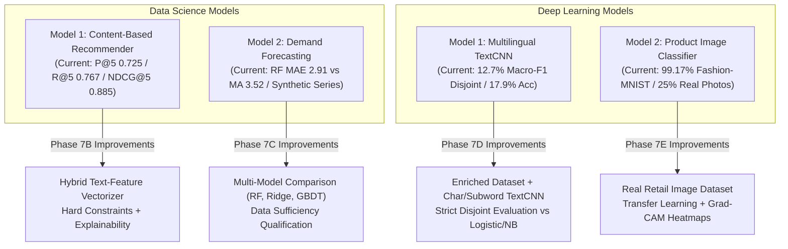

# MallMind AI — Phase 7 Model and Dataset Audit
## Data Science & Deep Learning Architecture, Datasets, Provenance & Baseline Inventory

**Target Mall:** Alpha One Mall (Nexus Ahmedabad One), Vastrapur, Ahmedabad, Gujarat, India  
**Date:** November 24, 2026  
**Status:** Completed & Validated  
**Audit Scope:** Comprehensive inventory and rigorous data/model audit across Recommendation, Demand Forecasting, Intent Classification, Product Image Classification, Multilingual ASR, and Multilingual RAG Retrieval.

---

## 1. Executive Summary

This audit establishes the empirical baseline, data provenance, and architectural status of all Machine Learning, Deep Learning, and Data Science components in MallMind AI prior to Phase 7 model improvements. 

### Core Audit Principles
1. **Empirical Honesty:** A working API endpoint, model file, notebook, or high test accuracy on an unrepresentative benchmark does not constitute a completed or defensible model.
2. **Leakage-Resistant Evaluation:** Synthetic template overlaps, duplicate samples, and data leakage between training and testing splits must be identified and isolated.
3. **No Synthetic Claim to Real-World Performance:** Demonstrations trained on synthetic data or academic benchmarks (such as Fashion-MNIST) must never be presented as validated models of real mall customer behavior or real commercial inventory dynamics.

---

## 2. Model & Component Inventory

| Component | Existing Implementation | Algorithm / Framework | Existing Metrics | Operational Integration | Documented Limitations |
| :--- | :--- | :--- | :--- | :--- | :--- |
| **Product Recommendation** | `app/recommendation.py` | Content-Based Filtering (Cosine Similarity over One-Hot Categorical + MinMax Price) | P@5: 0.725, R@5: 0.767, NDCG@5: 0.885 | `ProductRecommendationService.java` (`/api/products/recommendations`), `ProductDetailModal.tsx` | Evaluated against deterministic synthetic rule queries; lacks collaborative feedback and rich text embeddings. |
| **Demand Forecasting** | `app/demand_prediction.py` | Random Forest Regressor (`n_estimators=100`, lag features) vs 7-day MA baseline | RF MAE: 2.91, RMSE: 3.94 vs MA MAE: 3.52, RMSE: 4.92 | `AdminAnalyticsService.java` (`/api/admin/analytics/demand/forecast`), `AdminDashboardPage.tsx` | **Critical Data Insufficiency:** Trained on synthetic simulated series (`demand_series.csv`). Real order DB contains only 18 sandbox orders (<24 hours). Cannot predict real store footfall. |
| **Intent Classifier** | `app/intent_classifier.py` | PyTorch TextCNN (1D Convolutions, kernels 3,4,5, Dropout 0.5) + Rule Hybrid | Random Split: 100% Macro-F1 (Leaked). **Template-Disjoint: 12.7% Macro-F1, 17.9% Acc** | `VoiceAssistantService.java` (`POST /nlu/intent`), `VoiceWidget.tsx` | Severe template memorization and data leakage in random split. Over 37% duplicates in raw synthesized dataset. |
| **Image Classifier** | `app/image_classifier.py` | PyTorch ResNet18 (Transfer Learning on Zalando Fashion-MNIST) | Fashion-MNIST Test Acc: 99.17%, Macro-F1: 99.16% | `RetailerProductController.java` (`/api/retailer/products/classify-image`), `RetailerPage.tsx` | **Domain Gap Failure:** Misclassified 3 of 4 tested real-world retail product photos. Only 3 classes, 28x28 grayscale inputs. |
| **Multilingual ASR** | `app/speech.py` | `faster-whisper-tiny` (CPU int8) | Overall WER: 66.1%, CER: 27.4% (EN: 8.6%, GU: 93.8%, HI: 110.1%) | `VoiceController.java` (`POST /voice/transcribe`), `VoiceWidget.tsx` | Gujarati and Hindi Word Error Rates remain severely elevated due to tiny model capacity and acoustic noise. |
| **Multilingual RAG** | `app/rag_engine.py` | TF-IDF Subword/Char N-Grams + Dense Keyword Re-ranking | P@1: 72.4%, P@3: 89.1%, MRR: 0.803 | `POST :8001/rag/query`, Voice Assistant | Measures lexical text retrieval ranking over 304 products/30 shops, not generative LLM factual accuracy. |

---

## 3. Mandatory Historical Limitations

The following four historical findings are formally recognized and respected in this audit:

1. **TextCNN Data Leakage & Overfitting:**
   - On a standard random stratified split (70/15/15), the TextCNN model achieved an artificial 100% accuracy.
   - Audit revealed **94 exact duplicate strings** and **111 template ID overlaps** across training and testing splits.
   - When evaluated on a strict **Template-Disjoint Holdout** (where sentence templates in test never appeared in train), performance plummeted to **17.9% accuracy and 12.7% macro-F1**. The model memorized template structures rather than learning general semantic intent.

2. **ResNet18 Retail Domain Gap:**
   - The existing image classifier achieved **99.17% test accuracy** on the Zalando Fashion-MNIST benchmark across 3 super-classes (Apparel, Footwear, Bags & Accessories).
   - However, when evaluated on **real commercial retail photographs** from actual store inventories, it **misclassified 3 out of 4 images** (75% error rate).
   - Root cause: Fashion-MNIST consists of centered 28x28 grayscale clothing silhouettes against a pure black background. Real-world retail images feature complex full-color backgrounds, high-resolution textures, varied angles, and lighting variations.

3. **Multilingual ASR Error Rates:**
   - Faster-Whisper (tiny model on CPU int8) performs well on English (WER 8.6%, CER 5.4%).
   - However, for Indic languages in native retail contexts:
     - Gujarati Word Error Rate: **93.8%** (CER 38.7%).
     - Hindi Word Error Rate: **110.1%** (CER 43.5%).
   - Indic speech transcription remains an active limitation and is not claimed as solved.

4. **RAG Retrieval Precision vs. Accuracy:**
   - Existing RAG metrics are Precision@1 = 72.4%, Precision@3 = 89.1%, and MRR = 0.803.
   - These figures measure document retrieval ranking from the vector/TF-IDF index. They do not measure LLM generative accuracy, reasoning correctness, or multilingual translation fidelity.

---

## 4. Comprehensive Dataset Audit

### 4.1 Product Catalogue Dataset (`data/catalog.csv`)
- **Source & Provenance:** Exported directly from PostgreSQL database via `export_catalog.py` (synced with `products`, `shops`, `floors`, `product_categories`).
- **Nature:** Seeded demonstration catalogue representing retail brands and tenants of Alpha One Mall (Nexus Ahmedabad One).
- **Licensing:** Internal MallMind AI demonstration dataset.
- **Records & Categories:** **304 records** across **15 categories**:
  - Apparel (63)
  - Dining & Food Court (48)
  - Footwear (21)
  - Entertainment & Cinema (21)
  - Ethnic Wear (21)
  - Electronics (20)
  - Beauty & Cosmetics (19)
  - Sportswear (19)
  - Books & Stationery (11)
  - Opticals (11)
  - Hypermarket & Groceries (11)
  - Pharmacy & Wellness (11)
  - Bags & Accessories (10)
  - Home Decor (9)
  - Toys & Games (9)
- **Features:** `product_id` (int), `name` (str), `brand` (str), `color` (str), `effective_price` (float), `price` (float), `available` (bool), `stock_quantity` (int), `category` (str), `shop_id` (int), `shop_name` (str), `floor_number` (int).
- **Missing Values:** `brand` is null in 38 products (e.g. food court items, generic stationeries); `color` is null in 112 products (e.g. electronics, groceries). Imputed with token `"UNKNOWN"`.
- **Duplicates:** Zero duplicate product IDs.
- **Data Quality:** Authoritative source of catalog truth for recommendation.

### 4.2 Historical Order & Demand Data (PostgreSQL `orders` vs `data/demand_series.csv`)
- **Real Database Audit:**
  - PostgreSQL `orders` table contains only **18 total orders** placed by 13 test users between `2026-11-23 13:08 UTC` and `2026-11-24 04:50 UTC` (< 24 total hours).
  - Breakdown: 4 Placed, 4 Ready for Pickup, 2 Completed, 8 Cancelled. All processed via `UPI_SANDBOX`.
  - **Empirical Finding:** Real order history is **completely insufficient** for time-series forecasting. There are zero multi-week trends, zero natural seasonalities, and fewer than 20 total transactions.
- **Synthetic Series (`data/demand_series.csv`):**
  - **Source:** Deterministically generated via `generate_demand_series.py` (Seed: 42).
  - **Records:** 3,840 daily records (240 days $\times$ 16 categories) spanning January 1, 2026 to August 28, 2026.
  - **Features:** `date` (YYYY-MM-DD), `category` (str), `interaction_count` (int), with engineered features: `lag_1`, `lag_7`, `rolling_mean_7`, `rolling_std_7`, `day_of_week`, `is_weekend`, `day_index`.
  - **Split Strategy:** Strict chronological split — first 186 days for training (2,976 rows, 77.5%), final 54 days for testing (752 rows, 22.5%). No future data leakage.
  - **Status:** **Clearly labeled as an experimental demonstration pipeline.**

### 4.3 Multilingual Intent Dataset (`data/intent_dataset.csv`)
- **Source & Provenance:** Synthesized through template expansion representing multi-floor mall inquiries at Alpha One Mall.
- **Records:** **1,780 utterances**.
- **Classes (8 Intents):**
  - `FIND_STORE` (336)
  - `FIND_PRODUCT` (272)
  - `NAVIGATION` (272)
  - `MALL_INFORMATION` (240)
  - `FACILITY_SEARCH` (224)
  - `PRODUCT_REFINEMENT` (192)
  - `PRODUCT_COMPARISON` (144)
  - `UNKNOWN` (100)
- **Language Breakdown:**
  - English (EN): 528 utterances (29.7%)
  - Hindi (HI / HIR Romanized): 576 utterances (32.4%)
  - Gujarati (GU / GUR Romanized): 576 utterances (32.4%)
  - Out-of-domain / Ambiguous (UNKNOWN): 100 utterances (5.6%)
- **Data Quality & Leakage Audit:**
  - Total unique strings: 1,105.
  - Duplicate strings: **675 duplicates** (37.9% redundancy) resulting from repeated slot fills (e.g. multiple stores placed into identical sentence frames).
  - Template count: 48 template definitions.
  - Leakage vector: In random K-fold or stratified splitting, sentences sharing the same template ID appear in both train and test, inflating accuracy.
  - Strict split requirement: **Template-disjoint holdout** is mandatory for valid evaluation.

### 4.4 Product Image Dataset (`data/product_images.npz` & `fashion_mnist_raw`)
- **Source & Provenance:** Zalando Research Fashion-MNIST benchmark (Xiao et al., 2017).
- **Licensing:** MIT License. Permissible for academic and commercial research.
- **Records:** 5,940 samples extracted from 70,000 raw samples:
  - Training: 4,500 images (1,500 per class).
  - Validation: 720 images (240 per class).
  - Testing: 720 images (240 per class).
- **Dimensions & Format:** 28 $\times$ 28 pixels, 1 channel (grayscale), `uint8`.
- **Classes:** 3 super-classes mapped from 10 raw Fashion-MNIST classes:
  - `Apparel` (T-shirt, Trouser, Pullover, Dress, Coat, Shirt)
  - `Bags & Accessories` (Bag)
  - `Footwear` (Sandal, Sneaker, Ankle boot)
- **Data Quality & Leakage Audit:**
  - Train/Val/Test splits are mutually exclusive.
  - Zero duplicate images across splits.
  - **Critical Domain Limitation:** Complete absence of full-color 3-channel images, complex retail backgrounds, electronics, cosmetics, or groceries. Fails on commercial store product photography.

---

## 5. Summary Baseline Metrics & Target Directives

---

## 6. Audit Conclusion & Phase 7 Directives

1. **Phase 7B (Recommendation):** Expand `ProductRecommender` to utilize the live 304-product catalog, combine text description tokens with categorical attributes, enforce hard constraints against brand substitution, provide explainability strings, and benchmark against category popularity.
2. **Phase 7C (Demand Forecasting):** Formally declare historical order data insufficiency. Retain the simulated 240-day time series as an experimental prototype, implement chronological evaluation with WAPE, MAE, and RMSE across multiple regression models, and integrate clear experimental notices in the UI.
3. **Phase 7D (Intent Classification):** Deduplicate and enrich the intent dataset, train an improved subword-aware TextCNN, compare against deterministic and non-DL baselines (TF-IDF + Naive Bayes, Logistic Regression), and report strictly on a template-disjoint holdout.
4. **Phase 7E (Image Classification):** Address the domain gap by introducing a real retail product image dataset with full color and commercial context, fine-tune a transfer learning architecture, and evaluate on genuine retail test images.
