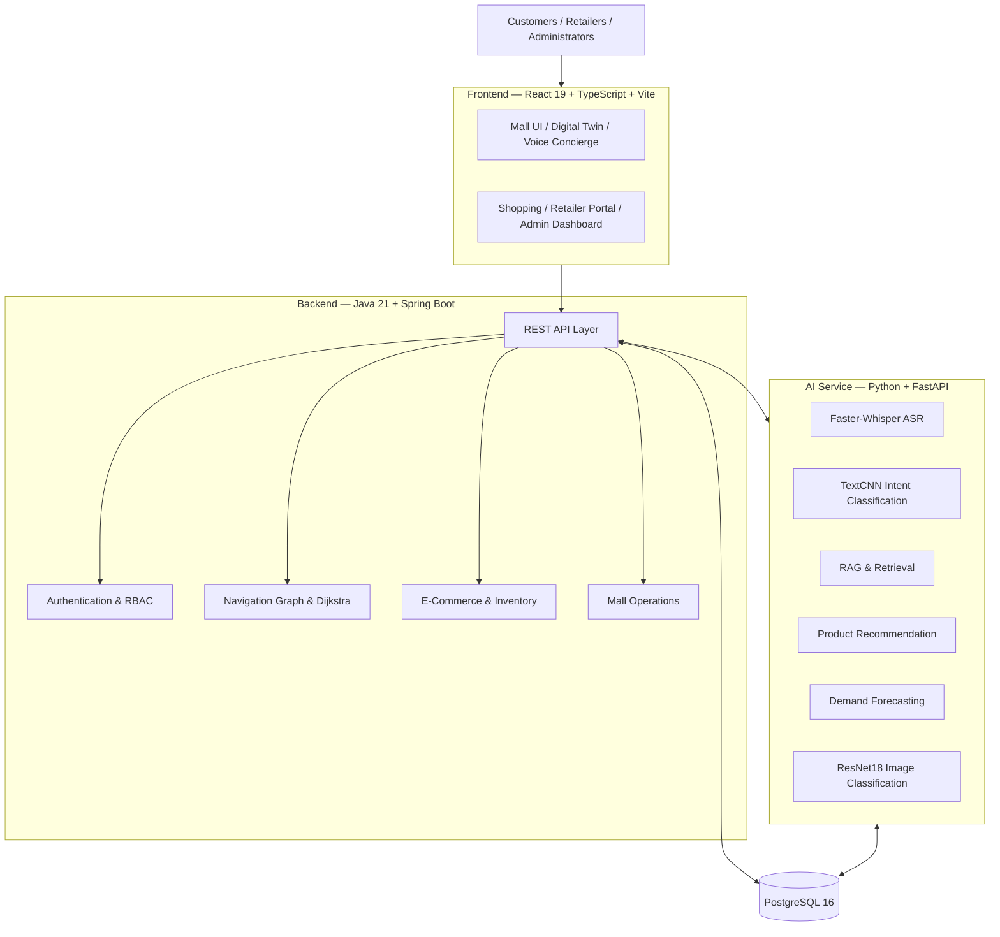

# MallMind AI 🏬
### Multilingual AI-Powered Mall Navigation & Smart Shopping Platform

<p align="center">
  An intelligent mall companion that connects indoor navigation, multilingual voice assistance, product discovery, e-commerce, and retail operations in one integrated platform.
</p>

<p align="center">
  <strong>Target Mall:</strong> Nexus Ahmedabad One (Alpha One Mall)<br/>
  Vastrapur, Ahmedabad, Gujarat, India
</p>

<p align="center">
  
  
  
  
  
  
</p>

---

## 📌 Overview

**MallMind AI** is a multilingual mall navigation and smart-shopping platform designed around Nexus Ahmedabad One in Ahmedabad, India.

Traditional mall experiences often require visitors to navigate separate directories, store information systems, product catalogues, and customer-service channels. MallMind AI brings these experiences together through an integrated digital platform.

It combines a five-floor schematic mall digital twin, graph-based indoor navigation, multilingual voice interaction, AI-powered product discovery, e-commerce workflows, and dedicated retailer and administrator portals.

The project demonstrates how Artificial Intelligence, Machine Learning, Deep Learning, Data Science, Software Engineering, Database Management, and E-Commerce can work together in a single application.

## ✨ Key Features

### 1. Interactive Mall Digital Twin

- Five-floor mall representation.
- Interactive floor maps and store directory.
- Store and facility discovery.
- Floor-based navigation.
- Graph-based route calculation using Dijkstra's algorithm.
- Elevator and escalator transitions.
- Accessible routing using elevator paths.
- Estimated physical-distance display.

### 2. Multilingual AI Voice Concierge

Interact with the mall through natural language in:

- Gujarati
- Hindi
- English

The voice assistant supports:

- Store discovery.
- Product discovery.
- Facility search.
- Indoor navigation requests.
- Product comparison.
- Product refinement.
- Mall-related information queries.

**AI pipeline:**

Microphone Input → Speech Recognition → Intent Classification → Retrieval and Context Processing → Backend Tool Execution → Response Generation → Text-to-Speech

The speech-processing and language-understanding components combine Faster-Whisper, a TextCNN intent classifier, retrieval-augmented generation (RAG), and backend service integration.

### 3. Smart Shopping & E-Commerce

- Product catalogue and store-based discovery.
- Search and filtering by brand, category, price, and availability.
- Product recommendations.
- Product details.
- Shopping cart management.
- Server-side price and stock validation.
- Checkout and order creation.
- Store pickup and supported mall fulfilment workflows.
- Order history and cancellation.
- Sandbox payment processing.

### 4. Retailer Portal

Retailers can manage their assigned store operations through a dedicated interface.

- Store-specific product management.
- Product catalogue administration.
- Inventory adjustments.
- Low-stock and out-of-stock alerts.
- Inventory adjustment history.
- Order management.
- AI-assisted product image category suggestions.

### 5. Administrator Dashboard

The administrator interface provides mall-wide operational visibility and management.

- Mall overview and dashboard analytics.
- Floor and facility management.
- Store management.
- Retailer onboarding and account management.
- Product and inventory oversight.
- Mall-wide order management.
- Audit-log viewing.
- Demand forecasting demonstrations.

### 6. Data Science & Deep Learning

MallMind AI incorporates four principal Data Science and Deep Learning components:

| Model | Approach | Application |
|---|---|---|
| Product Recommendation | TF-IDF, feature representations and cosine similarity | Product discovery |
| Demand Forecasting | Machine Learning regression models | Experimental category-demand estimates |
| Intent Classification | Subword-based TextCNN | Multilingual query understanding |
| Product Image Classification | ImageNet-pretrained ResNet18 transfer learning | Retailer-assisted product categorisation |

Model evaluation includes baseline comparisons, held-out testing, classification metrics, error analysis, and documented dataset limitations.

---

## 🏗️ System Architecture

MallMind AI follows a four-tier architecture with separate frontend, backend, AI, and database services.



### Technology Stack

| Layer | Technologies |
|---|---|
| Frontend | React 19, TypeScript, Vite |
| Backend | Java 21, Spring Boot, Spring Security |
| AI & ML | Python 3.11+, FastAPI, PyTorch, Scikit-learn |
| Speech Recognition | Faster-Whisper |
| Deep Learning | TextCNN, ResNet18 |
| Retrieval & Recommendation | RAG, TF-IDF, Cosine Similarity |
| Database | PostgreSQL 16 |
| ORM & Persistence | Spring Data JPA, Hibernate |
| Authentication | JWT, BCrypt, Role-Based Access Control |
| Containerisation | Docker, Docker Compose |
| Visualisation | Interactive SVG-based mall maps |

---

## 🧭 Indoor Navigation

MallMind AI represents the mall as a graph containing navigation nodes and connections.

The navigation engine uses **Dijkstra's shortest-path algorithm** to calculate routes between locations.

The graph represents:

- Store locations.
- Corridors and junctions.
- Floor transitions.
- Elevators.
- Escalators.
- Navigation facilities.

The reported validation graph contains:

- 67 navigation nodes.
- 74 graph edges.
- 5 represented floors.
- 1 connected component.

The displayed physical distance is an estimate derived from a schematic coordinate scale. It is not a surveyed architectural measurement.

---

## 🤖 AI & Machine Learning Implementation

### Product Recommendation

A hybrid content-based recommendation approach uses product text and catalogue attributes to rank relevant products.

The system considers:
- Product category.
- Brand.
- Product descriptions.
- Price constraints.
- Availability.
- User-selected preferences.

Hard constraints prevent silent brand substitution and exclude unavailable products from eligible recommendations.

**Evaluation qualification:** The original MAP@5 evaluation used relevance labels derived from the same filtering constraints as candidate selection. Consequently, its reported MAP@5 of 1.000 does not establish independent ranking quality.

### Demand Forecasting

The forecasting component demonstrates category-level demand estimation using machine-learning regression.

Its evaluation uses a simulated 240-day interaction series across 15 categories.

The reported Gradient Boosting Decision Tree result was:

- WAPE: 13.27%.
- MAE: 2.77 units.

The underlying mall database does not contain sufficient real historical commercial demand data to validate real-world forecasting. Forecasts are therefore explicitly presented as experimental demonstrations.

### Multilingual Intent Classification

The intent-classification system uses a subword-based TextCNN to process multilingual and morphologically varied queries.

Reported strict template-disjoint evaluation:

- Test examples: 340.
- Accuracy: 44.41%.
- Macro-F1: 43.20%.

The model improves over the previous word-level TextCNN, but its generalisation remains limited. Low-confidence predictions trigger clarification or fallback handling.

### Product Image Classification

The image-classification component uses transfer learning with ImageNet-pretrained ResNet18.

Reported benchmark results:

- Test images: 720.
- Categories: Apparel, Bags, Footwear.
- Accuracy: 99.17%.
- Macro-F1: 99.16%.

The model exhibits a significant domain gap on real-world retail photographs. It is an experimental classification assistant, not a validated commercial retail vision system. Manual category selection remains available as a fallback.

---

## 🔐 Security & Data Integrity

Security and access-control mechanisms include:

- JWT-based authentication.
- Role-Based Access Control.
- BCrypt password hashing.
- Customer and retailer data isolation.
- Store-level retailer access restrictions.
- Server-side checkout validation.
- Database foreign-key constraints.
- Transactional order processing.
- Inventory adjustment ledgers.
- Application-level audit-log protection.

The audit-log implementation is application-level and API-enforced; it is not database-level immutable storage.

Concurrent checkout under high contention has a documented lost-update risk because row-level locking or optimistic versioning has not been fully implemented and verified.

---

## 🧪 Testing & Quality Assurance

MallMind AI underwent a comprehensive quality-assurance process covering customer journeys, retailer operations, administration, security, database integrity, AI reliability, navigation, performance, and accessibility.

### Phase 8 QA Results

<p align="center">
  <strong>121 / 124</strong><br/>
  <strong>97.6% Reported Test Pass Rate</strong>
</p>

| Metric | Result |
|---|---:|
| Total evaluated scenarios | 124 |
| Passed | 121 |
| Failed | 3 |
| Overall pass rate | 97.6% |
| P0 defects | 0 reported |
| P1 defects | 0 reported |
| Documented P2 issues | 2 |
| Documented P3 optimisations | 3 |

The three failed assertions concerned conversational refinement on non-templated voice queries. The system prompted users for clarification rather than producing runtime failures.

**Final QA Verdict:** Ready with documented limitations.

---

## ⚙️ Installation & Setup

### Prerequisites

Install the following:

- Java 21 JDK.
- Python 3.11 or later.
- Node.js.
- Docker Desktop.
- Git.

PostgreSQL 16 is run through Docker Compose in the supplied project setup.

### Clone the Repository

```bash
git clone https://github.com/riyas2509/MallMind-AI.git
cd MallMind-AI
```

### Configure Environment

Review the environment configuration template and prepare the required local configuration.

Never commit actual credentials, API keys, JWT signing secrets, or private environment files.

### Start the Application

On Windows, with Docker Desktop running:

```bat
run-mallmind.bat
```

The startup script is designed to launch:

| Service | Local Address |
|---|---|
| Frontend | http://localhost:5173 |
| Java Backend | http://localhost:8085 |
| Python AI Service | http://localhost:8001 |
| FastAPI Swagger Documentation | http://localhost:8001/docs |
| PostgreSQL | localhost:5433 |

For detailed installation instructions and platform-specific setup, refer to the [Setup Guide](MALLMIND_AI_SETUP_GUIDE.md).

### Stop the Application

```bat
stop-mallmind.bat
```

Refer to the [Operational Runbook](MALLMIND_AI_RUNBOOK.md) for service health checks, logs, database backups, and troubleshooting.

---

## 📂 Repository Structure

```text
MallMind-AI/
│
├── backend/                       # Java Spring Boot backend
│
├── frontend/                      # React + TypeScript application
│
├── model-service/                 # Python FastAPI AI service
│
├── data/
│   └── seed/                      # Database seed data
│
├── MALLMIND_AI_FINAL_PROJECT_REPORT.md
├── MALLMIND_AI_FINAL_PRESENTATION.pptx
├── MALLMIND_AI_ARCHITECTURE_DIAGRAMS.md
├── MALLMIND_AI_LIVE_DEMO_RUNBOOK.md
│
├── MALLMIND_AI_SETUP_GUIDE.md
├── MALLMIND_AI_RUNBOOK.md
├── MALLMIND_AI_VIVA_QUESTION_BANK.md
│
├── MALLMIND_AI_PHASE3_DIGITAL_TWIN_REPORT.md
├── MALLMIND_AI_PHASE4_INTELLIGENCE_REPORT.md
├── MALLMIND_AI_PHASE4_CLOSURE_REPORT.md
├── MALLMIND_AI_PHASE5_IMPLEMENTATION_REPORT.md
├── MALLMIND_AI_PHASE5_CLOSURE_AUDIT.md
├── MALLMIND_AI_PHASE6_IMPLEMENTATION_REPORT.md
├── MALLMIND_AI_PHASE6_CLOSURE_REPORT.md
│
├── MALLMIND_AI_PHASE7_MODEL_AND_DATA_AUDIT.md
├── MALLMIND_AI_PHASE7_DATA_SCIENCE_REPORT.md
├── MALLMIND_AI_PHASE7_DEEP_LEARNING_REPORT.md
├── MALLMIND_AI_PHASE7_MATHEMATICAL_FOUNDATIONS.md
├── MALLMIND_AI_PHASE7_INTEGRATION_REPORT.md
├── MALLMIND_AI_PHASE7_FINAL_VERIFICATION_REPORT.md
├── MALLMIND_AI_PHASE7_FINAL_CLOSURE_AUDIT.md
│
├── MALLMIND_AI_PHASE8_SYSTEM_TEST_PLAN.md
├── MALLMIND_AI_PHASE8_FINAL_QA_REPORT.md
├── MALLMIND_AI_PHASE8_SECURITY_AUDIT.md
├── MALLMIND_AI_PHASE8_AI_RELIABILITY_REPORT.md
├── MALLMIND_AI_PHASE8_DATABASE_INTEGRITY_REPORT.md
├── MALLMIND_AI_PHASE8_NAVIGATION_VALIDATION_REPORT.md
├── MALLMIND_AI_PHASE8_PERFORMANCE_REPORT.md
├── MALLMIND_AI_PHASE8_RETAILER_ADMIN_REPORT.md
├── MALLMIND_AI_PHASE8_CUSTOMER_JOURNEY_REPORT.md
├── MALLMIND_AI_PHASE8_UI_ACCESSIBILITY_REPORT.md
├── MALLMIND_AI_PHASE8_DEFECT_REGISTER.md
│
├── MALLMIND_AI_PHASE9_REPOSITORY_AUDIT.md
├── MALLMIND_AI_PHASE9_SUBMISSION_READINESS_REPORT.md
│
├── docker-compose.yml
├── run-mallmind.bat
├── stop-mallmind.bat
├── package.json
├── package-lock.json
├── .gitignore
└── README.md
```

*The structure above highlights the principal project directories and documentation. Refer to the repository for the complete file listing.*

---

## 📚 Project Documentation

The repository contains technical and academic documentation covering the complete development lifecycle.

| Document | Description |
|---|---|
| [Final Project Report](MALLMIND_AI_FINAL_PROJECT_REPORT.md) | Comprehensive academic project report |
| [Architecture Diagrams](MALLMIND_AI_ARCHITECTURE_DIAGRAMS.md) | System architecture and technical diagrams |
| [Setup Guide](MALLMIND_AI_SETUP_GUIDE.md) | Installation and configuration |
| [Operational Runbook](MALLMIND_AI_RUNBOOK.md) | Startup, shutdown, health checks and troubleshooting |
| [Live Demo Runbook](MALLMIND_AI_LIVE_DEMO_RUNBOOK.md) | Structured demonstration workflow |
| [Viva Question Bank](MALLMIND_AI_VIVA_QUESTION_BANK.md) | Technical questions and defence preparation |
| [Phase 7 Final Audit](MALLMIND_AI_PHASE7_FINAL_CLOSURE_AUDIT.md) | Data Science and Deep Learning validation |
| [Phase 8 Final QA](MALLMIND_AI_PHASE8_FINAL_QA_REPORT.md) | Complete system quality-assurance report |
| [Phase 9 Repository Audit](MALLMIND_AI_PHASE9_REPOSITORY_AUDIT.md) | Final repository assessment |
| [Submission Readiness](MALLMIND_AI_PHASE9_SUBMISSION_READINESS_REPORT.md) | Academic submission-readiness assessment |

---

## ⚠️ Known Limitations

MallMind AI is an academic engineering prototype. Its capabilities and evaluation results must be understood within the following limitations.

| Area | Limitation |
|---|---|
| Digital Twin | Schematic representation rather than surveyed architectural CAD plans |
| Navigation | Physical distances are estimated using a 0.25 m/unit calibration |
| Indoor Positioning | No live indoor GPS or infrastructure-based positioning |
| Inventory | Seeded demonstration inventory; no live POS/ERP synchronization |
| Payments | Sandbox payment processing, not real financial settlement |
| Tax | Uniform 18% GST is a prototype assumption, not universal tax treatment |
| Demand Forecasting | Evaluation uses simulated historical interaction data |
| Intent Classification | Limited strict template-disjoint generalisation |
| Image Classification | Significant domain gap on real retail photography |
| Recommendation | Original MAP@5 evaluation has circular relevance-label limitations |
| Concurrency | High-contention checkout has a documented lost-update risk |
| Audit Logs | Application-level protection, not database-level WORM storage |

These limitations are retained in the technical reports and should be considered before any real-world commercial deployment.

---

## 🚀 Future Scope

Potential future improvements include:

- Integration with official architectural floor plans.
- More accurate indoor positioning.
- Live retailer POS and ERP integrations.
- Production payment gateway integration.
- Concurrency-safe inventory transactions.
- Improved multilingual ASR and intent classification.
- Retail-domain image datasets and model validation.
- Independent user-preference-based recommendation evaluation.
- Real historical mall demand data.
- Stronger audit-log integrity and retention controls.
- Deployment and scalability validation.

---

## 🎓 Academic Context

MallMind AI was developed as a multidisciplinary engineering capstone project integrating concepts from:

- Java Programming and Object-Oriented Design.
- Software Engineering.
- Database Management Systems.
- E-Commerce.
- Data Science.
- Deep Learning.
- Linear Algebra.
- Startup Creation and Business Modelling.
- Presentation and Communication Skills.

The project demonstrates the integration of these academic disciplines into a single multi-service software application.

---

## 👩‍💻 Author

**Riya Mayank Shah**

B.Tech — Artificial Intelligence & Machine Learning

GitHub: [@riyas2509](https://github.com/riyas2509)

Project Repository: [MallMind-AI](https://github.com/riyas2509/MallMind-AI)

---

## 📄 License

No open-source license has been specified yet.

Until a license is added, the repository should not be assumed to grant permission to reuse, modify, or redistribute its code or assets.

---

<p align="center">
  <strong>MallMind AI</strong><br/>
  Making Physical Mall Experiences More Intelligent.<br/><br/>
  Built with AI, Software Engineering, and a focus on connected retail experiences.
</p>
